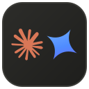

<div align="center">



# Claude & Antigravity Usage Monitor for Windows

**Bring official Claude Code & Antigravity quotas and local token analytics together in the Windows system tray and desktop floating pill.**

Built as a **2-in-1 native Windows 10 / 11 desktop app** inspired by [**kittors/claude-usage-monitor**](https://github.com/kittors/claude-usage-monitor) and [**cassianpan/antigravity-usage-monitor**](https://github.com/cassianpan/antigravity-usage-monitor).<br>
Powered by [`egoist/mygo`](https://github.com/egoist/mygo) — Pure Go, Zero CGO, Direct3D 11 native GPU UI (no WebView2 required).

<p align="center">
  <a href="https://github.com/imhu/cc-usage-monitor/releases/latest"></a>
  
  <a href="go.mod"></a>
  
</p>

[**Download Latest**](https://github.com/imhu/cc-usage-monitor/releases/latest) · [**简体中文**](README.zh-CN.md) · [Highlights](#highlights) · [Build & Run](#build-and-run-from-source) · [Acknowledgments](#acknowledgments)

</div>

<br>

## Highlights

<table>
<tr>
<td width="50%" valign="top">

**Dual Providers, Instant Header Switcher**<br>
Monitor both Claude and Antigravity inside one lightweight client. Click the top title dropdown (or press `Ctrl+1` / `Ctrl+2`) to switch seamlessly between *Claude usage* and *Antigravity usage*, updating the tray icon, floating pill, and exit check in sync.

</td>
<td width="50%" valign="top">

**Exact Official Claude Quotas, Never Guessed**<br>
Calls the exact same `GET /api/oauth/usage` and `/api/oauth/profile` endpoints as Claude Code `/usage`, matching 5-hour, weekly, and per-model floored percentages 1:1. Watches `~/.claude.json` to reuse fresh cache within 60 seconds with zero extra requests.

</td>
</tr>
<tr>
<td valign="top">

**Silent Antigravity Sync via `agy` CLI**<br>
Follows the official `agy` CLI `statusLine` contract using a hidden Windows ConPTY session, merged `--settings`, quote-free `.cmd` wrapper, and `AGY_CLI_DISABLE_AUTO_UPDATE=true` (zero console flash, zero packet capture, and zero edits to your `~/.gemini/antigravity-cli/settings.json`). Unused quota groups collapse automatically.

</td>
<td valign="top">

**Safe Line (Pace Line) Early Warning**<br>
Both 5-hour and weekly bars display a white safe-pace tick showing how much quota you can spend right now and still last until reset (with a 30-minute / 10% warm-up buffer on Antigravity 5h). Over-pace usage turns red; expired windows auto-zero locally; hover to inspect exact headroom.

</td>
</tr>
<tr>
<td valign="top">

**Anti-429 Scheduler & Lock-Safe OAuth Renewal**<br>
Syncs Claude only when active usage can move the percentage, backed by a persistent token bucket (max 1 auto check per ~20 min, reserved manual refresh allowance, and 15–60 min exponential 429 backoff). Supports directory-lock-safe OAuth refresh compatible with Claude Code plus subscription/login expiry alerts.

</td>
<td valign="top">

**Exit IP Check & IPv6 Leak Guard**<br>
Displays exit country/region, proxy tag, and masked IP on both panels. Probes `api.anthropic.com/cdn-cgi/trace` over forced IPv4 before Claude requests—pausing automatically and raising a red shield in restricted regions—while independently detecting IPv6 direct leaks.

</td>
</tr>
<tr>
<td valign="top">

**Incremental Logs, Exact Decode Speed & Multi-Currency**<br>
Incrementally parses local transcripts for Monthly / Weekly / Daily API-equivalent spend, 3-tier projections, token breakdown, cache hit rate & savings, cost-sorted model splits (merging >3 models into *Other* with largest-remainder rounding), 14-day bars, exact TTFT-excluded decode speed (`tok/s`), and 12 currencies with hourly Frankfurter FX rates.

</td>
<td valign="top">

**Native Tray, Transparent Floating Pill & Self-Updater**<br>
Animated Clawd / star tray icon, acrylic-style flyout panel (with 2.5s live refresh while open and sliding segmented tabs), Windows borderless transparent floating pill (auto-fit width, GPU shadow, drag memory, always-on-top), and built-in GitHub Release update badge with SHA256-verified in-place update & relaunch.

</td>
</tr>
</table>

## Data Sources & Privacy

Official quotas and local analytics are strictly separated. Transcript logs never leave your machine, and both providers support English / Chinese UI and independent settings:

| Dimension | Claude Usage Mode | Antigravity Usage Mode |
| :--- | :--- | :--- |
| **Design Inspiration** | [kittors/claude-usage-monitor](https://github.com/kittors/claude-usage-monitor) | [cassianpan/antigravity-usage-monitor](https://github.com/cassianpan/antigravity-usage-monitor) |
| **Official Quota Source** | `GET https://api.anthropic.com/api/oauth/usage` & `/api/oauth/profile` (plus `%USERPROFILE%\.claude.json` cache reuse) | Official `agy` CLI `statusLine` JSON captured silently via Windows ConPTY + merged `--settings` (no packet capture) |
| **Local Log Path** | `%USERPROFILE%\.claude\projects\**\*.jsonl` (including subagents, deduplicated by `message.id + requestId`) | `%USERPROFILE%\.gemini\antigravity\brain\**\transcript.jsonl` + SQLite step timings (`decode_ms` / `ttft_ms`) |
| **Credentials Handling** | Reads `.credentials.json` in memory; uses Claude Code's cross-process directory locks for safe OAuth token refresh | **Never touches auth tokens**; delegates authentication entirely to your local `agy` CLI session (with auto-closing terminal sign-in) |
| **Proxy & Exit Safety** | Custom HTTP/SOCKS5 or Windows system proxy; forced IPv4 exit check + IPv6 leak warning before Claude API calls | Shared Exit IP row & proxy/country badge; `agy` inherits your system/environment proxy settings |
| **Custom Paths** | Custom `.claude` config directory and session log directory | Custom `agy` binary path, `brain` directory, and CLI config directory |

## How It Works

<details>
<summary><b>1. Claude Official Quota, Anti-429 Scheduling & Lock-Safe OAuth Renewal</b></summary>
<br>

- **Credential Reading & Safe Refresh**: Reads `.credentials.json` only from your configured `.claude` directory (default `%USERPROFILE%\.claude`). When an access token nears expiry and *Auto-renew login* is enabled, it acquires the same directory locks as Claude Code (`.oauth_refresh.lock`, `.storage-write.lock`) with retry/merge logic so concurrent writes never clobber refresh tokens.
- **Anti-429 Protection**: Evaluates token delta since the last fetch, window progress, and cooldown before querying. Automatic and manual requests share a persistent token bucket (avg 1 request per 20 min, reserving quota for manual *Refresh*), backing off 15–60 min on HTTP 429.
- **Subscription & Expiry Alerts**: Reads plan tier (`Pro` / `Max` / `Ultra`) and billing health from `/api/oauth/profile`, computes days remaining until your billing day, and alerts before renewal or login expiry.

</details>

<details>
<summary><b>2. Antigravity ConPTY Silent Sync & Local Analytics</b></summary>
<br>

- **Hidden ConPTY Capture on Windows**: Locates `agy` via custom path -> `PATH` -> `%LOCALAPPDATA%\agy\bin\agy.exe`, merges your existing `~/.gemini/antigravity-cli/settings.json` keys with a temporary `statusLine` `.cmd` hook, strips nested `ANTIGRAVITY_*`/`AGY_*` variables, and sets `AGY_CLI_DISABLE_AUTO_UPDATE=true` so background syncs never flash an updater console window or consume LLM tokens.
- **Smart Grouping & Safe Cleanup**: Groups `Gemini` (5h / Weekly) and `Third-Party` buckets, auto-collapsing unused non-primary groups. Excludes `ccmonitor`'s own probe child tree from *Active Processes*, highlights detached `agy CLI` instances, and supports hover *Force quit* with PID-reuse protection.
- **Exact Decode Speed & Model Breakdown**: Reads step timings from Antigravity's local SQLite metadata to compute TTFT-excluded median decode speed (`tok/s`), falls back gracefully to transcript gaps, aggregates Spend across Month / Week / Day with 3-tier projections, and merges >3 models into *Other* with largest-remainder rounding so shares sum to `100%` and amounts sum strictly to the header total.

</details>

<details>
<summary><b>3. Exit Safety Check (Forced IPv4 Probe + IPv6 Leak Detection)</b></summary>
<br>

- Supports manual HTTP / SOCKS5 proxies or automatic Windows system proxy detection.
- Forces an IPv4 probe to `api.anthropic.com/cdn-cgi/trace` before every Claude API request; if the exit resolves to CN/HK/MO, Claude requests pause immediately with a warning shield.
- Independently probes IPv6 connectivity to catch direct IPv6 leaks when only IPv4 is proxied.
- Automatically re-probes on network or proxy changes, updating the Clawd tray shield state in real time.

</details>

<details>
<summary><b>4. Borderless Floating Pill, Customization & In-App Self-Updater</b></summary>
<br>

- **Windows Borderless Transparent Pill**: Uses a frameless `WS_POPUP` window with DWM corner/border suppression disabled so all four `14px` corners remain cleanly transparent with a GPU-rendered drop shadow. Auto-fits width to visible metrics, remembers dragged screen coordinates, supports Always-on-Top, and offers a right-click quick menu.
- **Modular Panel & Smooth Controls**: Every section (*Limits*, *Output speed*, *Spend*) supports *Detailed / Compact / Hidden* modes and collapsible headers, plus smooth sliding segmented tabs (`180ms`), 2.5s lightweight live refresh while the panel is open, and 12 currencies with hourly Frankfurter FX rates.
- **In-App Update Checker & SHA256 Self-Updater**: Checks GitHub Releases periodically with `ETag` (`If-None-Match`) caching, shows a subtle blue badge on *Settings...* when a newer version is available, renders release notes in *Settings > General*, and downloads, verifies `SHA256SUMS.txt`, swaps the running `.exe` in place, and relaunches automatically.

</details>

## Prerequisites

- **Claude Mode**: Sign in once with Claude Code (generating `%USERPROFILE%\.claude\.credentials.json`), or point *Settings > Data* to your `.claude` directory. No requests are sent to Anthropic without valid credentials.
- **Antigravity Mode**: Install and sign in to `agy` CLI to read official quotas (or click *Sign in agy CLI* inside the panel—the terminal closes automatically once synced). Local `transcript.jsonl` cost and cache analytics work even without signing in.

## Build and Run from Source

### Requirements

- Windows 10 / 11 (`amd64` or `arm64`)
- [Go 1.27.3+](https://go.dev/dl/) (`GOTOOLCHAIN=auto` fetches the matching toolchain automatically)

### Clone, Test & Build

```powershell
# Clone the repository (HTTPS or SSH)
git clone https://github.com/imhu/cc-usage-monitor.git
# git clone git@github.com:imhu/cc-usage-monitor.git
cd cc-usage-monitor

# Run static checks, unit tests, and headless GPU UI tests
go vet ./...
go test -v -count=1 ./...

# Build a standalone GUI executable (no console window, no WebView2/inspector)
go build -trimpath -tags "mygo_nowebview mygo_noinspector" -ldflags "-H=windowsgui -s -w -X ccmonitor/internal/core.AppVersion=v1.0.3" -o build\ccmonitor.exe .\cmd\ccmonitor
```

### Run Modes

```powershell
# Normal mode (reads local Claude Code & Antigravity data automatically)
.\build\ccmonitor.exe

# Demo mode (preloads built-in sample data for both Claude & Antigravity)
.\build\ccmonitor.exe --demo

# Launch and immediately open the tray flyout panel
.\build\ccmonitor.exe --open
```

Built-in single-instance lock: launching `ccmonitor.exe` again activates the existing instance's panel. When started silently at Windows sign-in via *Settings > General > Launch at login*, it stays tucked in the system tray.

## Project Structure

<details>
<summary><b>Directory & Module Overview</b></summary>
<br>

```text
cmd/
  ccmonitor/
    main.go                  Entrypoint, tray menu, flyout panel, settings window, floating pill & CLI hooks
internal/
  core/
    provider.go              Provider enum (claude / antigravity) and shared helpers
    prefs.go                 Persistent preferences (per-provider settings, pill columns, currency, skipped update)
    format.go                Number/duration formatting, 12 currencies & hourly Frankfurter FX cache
    parser.go / index.go     Claude Code JSONL incremental scanner, deduplication & gob cache
    calculator.go            Claude Month / Week / Day spend, projections & 14-day trend
    pricing.go / tokens.go   Claude model pricing, cache multipliers & token breakdown
    official.go / autosync.go Claude /usage & /profile models, cache reuse & anti-429 scheduling
    budget.go / limitpace.go Persistent token bucket, backoff & 5h/weekly pace line math
    midweek_reset.go         Midweek quota reset calibration
    oauth.go / renewal.go    OAuth credential reading & lock-safe token refresh
    network.go               IPv4/IPv6 exit trace probes, region guard & proxy client builder
    speed.go                 Output speed sampling & stall detection
    tone.go                  Alert copy & tone helpers
    updater.go               Semver comparison, GitHub Releases parser, SHA256SUMS parser & Markdown cleaner
    ag_models.go             Antigravity snapshot, quota buckets & local report models
    ag_bridge.go             Windows quote-free `.cmd` capture wrapper & settings.json bridge
    ag_quota.go              Antigravity 5h/weekly quota evaluation, 30m pace buffer & epoch reset handling
    ag_transcript.go         Antigravity `transcript.jsonl` incremental parser
    ag_step_times.go         SQLite step timing reader (`decode_ms` / `ttft_ms`)
    ag_aggregator.go         Antigravity spend, 3-tier projection, exact decode speed & "Other" model grouping
    ag_pricing.go            Gemini / Antigravity / 3P model pricing & display normalization
  platform/
    window_windows.go        Win32 native drag & borderless transparent `WS_POPUP` DWM helpers
    conpty_windows.go        Windows ConPTY headless runner, visible console login runner & env isolation
    process_windows.go       Claude / Antigravity process tree inspection, orphan detection & safe ForceQuitTask
    proxy_windows.go         Windows system proxy reader
    trayicon.go              Dynamic vector tray icon, Clawd pixel renderer & exit shield overlay
    update_windows.go        Zip extraction & atomic Windows `.old` binary in-place swap
    dirlock.go               Cross-process directory locks & AtomicWriteFile
    paths.go                 `.claude`, `brain`, `agy.exe` & AppData path resolution
  service/
    store.go                 Core state store, file watchers, 2.5s open-panel refresh, anti-429 loop & renewal
    updater.go               GitHub Release ETag checker, progress downloader & SHA256 self-updater
    ag_store.go              Antigravity local index & background sync coordinator
    ag_syncer.go             ConPTY silent syncer & auto-closing interactive `agy` login runner
    demo.go                  Dual-provider demo dataset (`--demo` & headless UI tests)
  ui/
    popover.go               Claude panel, top provider dropdown & shared header/footer/exit row
    popover_ag.go            Antigravity panel (grouped quotas, collapsible unused buckets, exact speed & spend)
    pill.go                  Windows borderless transparent floating pill
    settings.go              Settings window (Usage / Menubar / Panel / Data / General with Software Update card)
    widgets.go / theme.go / icons.go Shared GPU widgets, sliding SegmentedTabs, palette & vector icons
```

</details>

## Acknowledgments

Deeply grateful to the open-source projects that inspired and power this Windows edition:

- [**kittors/claude-usage-monitor**](https://github.com/kittors/claude-usage-monitor) — for the direct Claude quota architecture, pace line model, Clawd exit shield design, anti-429 scheduler, and clean UI density;
- [**cassianpan/antigravity-usage-monitor**](https://github.com/cassianpan/antigravity-usage-monitor) — for the zero-capture `agy` CLI `statusLine` sync contract, grouped quota folding, 3-tier projections, and local transcript analytics;
- [**egoist/mygo**](https://github.com/egoist/mygo) — for providing pure-Go, zero-CGO, Direct3D 11 native GPU rendering and windowing on Windows.

## Disclaimer

This is an open-source community tool combining and adapting two independent macOS projects for Windows. It has no official affiliation with Anthropic or Google. Claude, Antigravity, Gemini, and their respective names and marks are trademarks of their owners.
