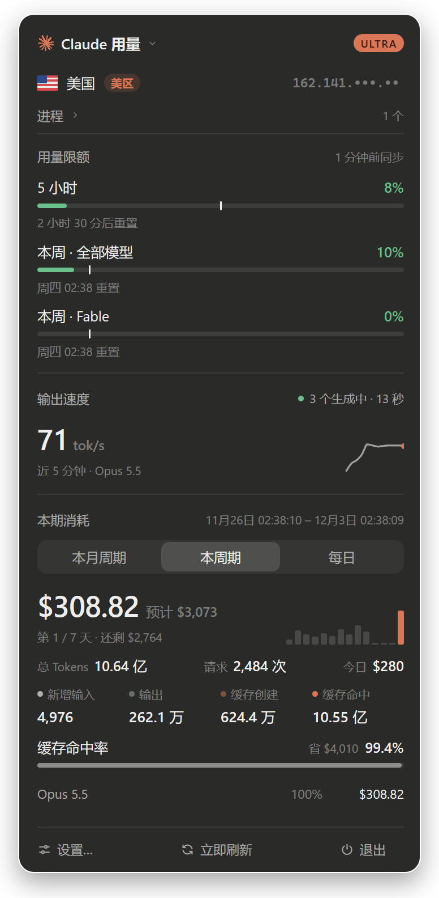
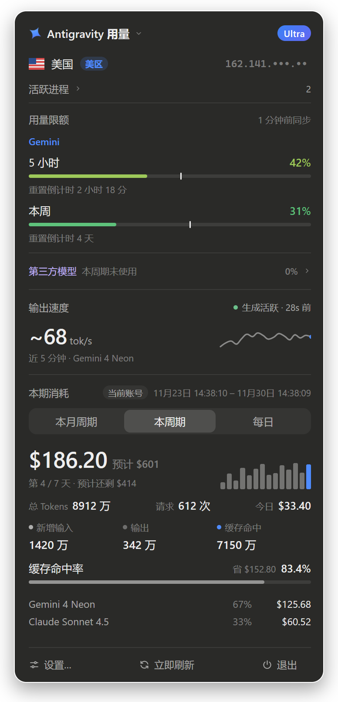

<div align="center">


# Claude & Antigravity Usage Monitor for Windows

**将 Claude Code 与 Antigravity 的官方额度与本地 Token 消耗，同时放进 Windows 原生系统托盘与桌面悬浮条。**

本项目深度整合了两个 macOS 开源项目 [**kittors/claude-usage-monitor**](https://github.com/kittors/claude-usage-monitor) 与 [**cassianpan/antigravity-usage-monitor**](https://github.com/cassianpan/antigravity-usage-monitor)，是面向 **Windows 10 / 11** 重新打造的**二合一原生桌面版**。<br>
基于 [`egoist/mygo`](https://github.com/egoist/mygo) 构建——纯 Go、零 CGO、Direct3D 11 原生 GPU UI（无需 WebView2）。

<p align="center">
  <a href="https://github.com/imhu/cc-usage-monitor/releases/latest"></a>
  
  <a href="go.mod"></a>
  
</p>

[**下载最新版**](https://github.com/imhu/cc-usage-monitor/releases/latest) · [**English**](README.md) · [界面预览](#界面预览) · [核心特性](#核心特性) · [从源码构建与运行](#从源码构建与运行) · [致谢](#致谢)

</div>

<br>

## 界面预览

<div align="center">
<table>
<tr>
<td align="center" width="50%">
<br>
<sub><b>Claude 用量面板</b></sub>
</td>
<td align="center" width="50%">
<br>
<sub><b>Antigravity 用量面板</b></sub>
</td>
</tr>
<tr>
<td align="center">
<br>
<sub><b>桌面悬浮条 — Claude</b></sub>
</td>
<td align="center">
<br>
<sub><b>桌面悬浮条 — Antigravity（执行扫光态）</b></sub>
</td>
</tr>
</table>
<sub><i>以上截图基于内置 <code>--demo</code> 演示数据渲染，IP 已脱敏处理，不含任何真实账号或本地日志信息。</i></sub>
</div>

## 核心特性

<table>
<tr>
<td width="50%" valign="top">

**双源整合，顶部下拉一键切换**<br>
把 Claude 与 Antigravity 两套用量监控整合在同一个轻量客户端中：点击面板顶部标题下拉菜单（或 `Ctrl+1` / `Ctrl+2`）即可在「Claude 用量」与「Antigravity 用量」之间无缝切换，系统托盘图标、桌面悬浮条与出口 IP 状态随之实时联动。

</td>
<td width="50%" valign="top">

**Claude 官方限额直读，拒绝估算**<br>
直连与 Claude Code `/usage` 相同的 `GET /api/oauth/usage` 与 `/api/oauth/profile` 接口，5 小时、每周与按模型额度向下取整完全一致；自动监听 `~/.claude.json` 复用最新官方缓存（60 秒内零请求）。

</td>
</tr>
<tr>
<td valign="top">

**Antigravity 官方 `agy` CLI 静默同步**<br>
遵循官方 `agy` CLI 的 `statusLine` 契约，在 Windows 上通过 ConPTY + 合并原配置的临时 `--settings`、无引号 `.cmd` 封装脚本与 `AGY_CLI_DISABLE_AUTO_UPDATE=true` 后台静默同步（零终端闪窗、零抓包、不篡改用户配置）；未使用的配额分组自动折叠。

</td>
<td valign="top">

**安全线（Pace Line）提前预警节奏**<br>
5 小时与每周进度条均带有安全线刻度，直观标出按当前时间进度消耗到哪里刚好能撑到重置（Antigravity 5 小时内置前 30 分钟 10% 起步缓冲）；超线变红预警，跨过重置时刻后本地即时归零，悬停即可查看安全线与余量。

</td>
</tr>
<tr>
<td valign="top">

**防 429 调度与登录自动续期（Claude）**<br>
仅在 Claude Code 活跃且消耗足以推动百分比变化时同步，内置持久化令牌桶（平均每 20 分钟最多 1 次、保留手动刷新配额、429 指数退避 15–60 分钟）。支持兼容 Claude Code 同款目录锁的 OAuth 自动续期，以及订阅/登录到期提醒。

</td>
<td valign="top">

**看得清出口与 IPv6 泄漏防护**<br>
双面板统一展示当前出口国家/地区、代理标签与脱敏 IP；每次请求 Claude 官方接口前强制走 IPv4 探测 `api.anthropic.com/cdn-cgi/trace`，在 CN/HK/MO 自动暂停并亮起红盾，同时独立探测 IPv6 直连泄漏。

</td>
</tr>
<tr>
<td valign="top">

**本地日志、纯解码输出速度与多币种**<br>
增量解析本地日志，统计本月周期 / 本周 / 今日 API 等效花费、3 档周期用满预测、缓存命中率与省费、按花费排序的模型拆分（超过 3 个自动合并为「其他」并用最大余数法保证加总 100%）、14 天柱图、扣除首字延迟（TTFT）的纯解码速度（`tok/s`）以及 12 种货币实时汇率。

</td>
<td valign="top">

**原生托盘、无边框悬浮条与一键自更新**<br>
动态托盘图标 + 左键浮层（展开期间 2.5 秒轻量刷新、平滑滑动周期切换底块、进程悬停强制退出）+ Windows 专属无边框全透明悬浮条；内置 GitHub Releases 更新角标与 `SHA256SUMS.txt` 校验的原地替换重启更新。

</td>
</tr>
</table>

## 双数据源对比与隐私

本项目严格区分官方额度与本地统计，会话日志永不离开本机，两个数据源均支持中英文界面与独立配置：

| 对比维度 | Claude 用量模式 | Antigravity 用量模式 |
| :--- | :--- | :--- |
| **灵感与设计来源** | [kittors/claude-usage-monitor](https://github.com/kittors/claude-usage-monitor) | [cassianpan/antigravity-usage-monitor](https://github.com/cassianpan/antigravity-usage-monitor) |
| **官方额度来源** | `GET https://api.anthropic.com/api/oauth/usage` 与 `/api/oauth/profile`（附带复用 `%USERPROFILE%\.claude.json` 缓存） | 官方 `agy` CLI 的 `statusLine` JSON（通过 Windows ConPTY + 合并 `--settings` 静默获取，绝不抓包） |
| **本地日志路径** | `%USERPROFILE%\.claude\projects\**\*.jsonl`（含子 Agent，按 `message.id + requestId` 流式去重） | `%USERPROFILE%\.gemini\antigravity\brain\**\transcript.jsonl` + SQLite 步骤耗时（`decode_ms` / `ttft_ms`） |
| **登录与凭据处理** | 读取 `.credentials.json` 并在内存中携带；启用自动续期时使用与 Claude Code 相同的目录锁安全写回 | **不触碰任何登录凭据**，完全交由本机 `agy` CLI 自身会话维护（面板一键登录成功后自动关闭终端） |
| **代理与出口安全** | 支持自定义 HTTP/SOCKS5 代理或 Windows 系统代理；请求前强制 IPv4 出口检查 + IPv6 泄漏告警 | 展示同款出口 IP 行与代理/国家标识；`agy` 同步直接复用本机环境网络设置 |
| **自定义路径配置** | 支持自定义 `.claude` 配置目录与会话日志目录 | 支持自定义 `agy` 可执行文件路径、`brain` 目录与 CLI 配置目录 |

## 工作原理

<details>
<summary><b>1. Claude 官方额度、防 429 调度与目录锁自动续期</b></summary>
<br>

- **凭据读取与安全续期**：仅读取指定配置目录（默认 `%USERPROFILE%\.claude`）内的 `.credentials.json`；当访问令牌临近过期且开启「自动续期登录」时，使用与 Claude Code 一致的目录锁（`.oauth_refresh.lock`、`.storage-write.lock` 等）和重试合并逻辑安全刷新，仅更新 OAuth 字段，避免并发写冲突丢失 refresh token。
- **防 429 触发策略**：结合本周期 Token 消耗步长、窗口内增量与上次刷新时间判断是否值得请求；所有自动与手动请求共享持久化令牌桶，平均每 20 分钟最多 1 次，并始终为手动「立即刷新」预留配额；遇到 HTTP 429 后触发 15 分钟起步的指数退避（最长 60 分钟）。
- **订阅与到期提醒**：通过 `/api/oauth/profile` 读取套餐档位（Pro / Max / Ultra）与订阅状态，按设定的每月扣费日计算当前周期剩余天数，并在临近扣费或登录即将失效时提示。

</details>

<details>
<summary><b>2. Antigravity ConPTY 后台同步、纯解码速率与本地统计</b></summary>
<br>

- **Windows 端 ConPTY 静默捕获**：按自定义路径 → `PATH` → `%LOCALAPPDATA%\agy\bin\agy.exe` 顺序定位 `agy` CLI，读取并保留用户 `~/.gemini/antigravity-cli/settings.json` 中的原有字段后仅覆写临时 `statusLine`，注入 `AGY_CLI_DISABLE_AUTO_UPDATE=true` 禁止后台自更新进程弹窗，整个过程无黑框、不消耗模型 Token、不修改用户原配置。
- **活跃进程与孤儿清理**：按父子进程树整棵排除自身后台同步探针防止计数闪跳；识别脱离终端的孤儿 `agy CLI` 并标注「无终端」，悬停进程行支持带进程创建时间校验的「强制退出」。
- **纯解码速度与模型合并**：从本地 SQLite 读取步骤耗时并扣除首字延迟（TTFT），取中位数计算纯解码速度（`tok/s`），无数据库耗时则自动回退到会话时间差估算；底部模型列表按花费降序排列，超过 3 个模型自动合并为「前 2 名 + 其他」（悬停可看内部全部模型），最大余数法保证占比严格相加等于 `100%` 且金额严格等于顶部总花费。

</details>

<details>
<summary><b>3. 出口安全检查（IPv4 强制探测 + IPv6 泄漏检测）</b></summary>
<br>

- 支持手动设置 HTTP / SOCKS5 代理，或自动读取 Windows 系统代理配置。
- 每次请求 Claude 官方接口前强制走 IPv4 访问 `api.anthropic.com/cdn-cgi/trace` 验证出口地区，若判定位于中国大陆、香港或澳门，则立即暂停自动/手动官方额度请求并警示。
- 独立探测本机是否存在 IPv6 直连 Anthropic 风险，发现直连泄漏时在面板与托盘盾牌上重点标红提醒。
- 当网络环境或代理配置变更时自动重新探测；无风险状态下托盘 Clawd 举起同色盾牌，风险或未确认时盾牌切换为警示状态。

</details>

<details>
<summary><b>4. 无边框透明桌面悬浮条、面板定制与内置自更新</b></summary>
<br>

- **Windows 专属无边框全透明悬浮条**：底层切换至无边框 `WS_POPUP` 并关闭 Windows 11 DWM 系统 8px 圆角描边与边框，保留完整的 `14px` 胶囊圆角与透明四角；通过 GPU 渲染贴合胶囊轮廓的柔和阴影，支持按当前可见指标列动态测量并自适应窗口宽度、按住左键原生拖拽移动与坐标记忆、始终置顶及右键快捷菜单。
- **模块化面板与平滑动效**：两套面板的「用量限额」「输出速度」「本期消耗」均支持「详细 / 简洁 / 隐藏」切换与标题折叠，周期切换配备 `180ms` 滑动底块动画，展开面板期间每 `2.5s` 自动轻量增量刷新，并支持 12 种货币与每小时刷新的 Frankfurter 实时汇率。
- **应用内更新角标与自更新**：启动及每 6 小时带 `ETag` 静默检查 GitHub Releases，发现新版本仅在「设置…」与「通用」标签显示蓝色角标；在「设置 › 通用」可展开更新日志、忽略版本，或点击「立即更新并重启」自动下载、校验 `SHA256SUMS.txt`、原地替换 `.exe` 并重启。

</details>

## 使用前提

- **Claude 用量模式**：建议先在本机登录一次 Claude Code（生成 `%USERPROFILE%\.claude\.credentials.json`），或在「设置 › 数据」中指定包含凭据的 `.claude` 目录；未检测到凭据时应用不会主动向 Anthropic 发起请求。
- **Antigravity 用量模式**：若要读取官方配额，请先安装并登录 `agy` CLI（未登录时可在主面板一键打开终端完成 `agy` 登录，同步完成后终端会自动关闭）；即使未登录 `agy`，本地 `transcript.jsonl` 花费与缓存统计仍可直接使用。

## 从源码构建与运行

### 环境要求

- Windows 10 / 11（64 位 `amd64` / `arm64`）
- [Go 1.27.3+](https://go.dev/dl/)（`GOTOOLCHAIN=auto` 会自动拉取匹配工具链）

### 克隆、测试与构建

```powershell
# 克隆仓库（HTTPS 或 SSH）
git clone https://github.com/imhu/cc-usage-monitor.git
# git clone git@github.com:imhu/cc-usage-monitor.git
cd cc-usage-monitor

# 静态检查与全量单元测试 / 无头 UI 渲染测试
go vet ./...
go test -v -count=1 ./...

# 构建无控制台窗口的轻量单文件原生程序（不含 WebView2 与检查器）
go build -trimpath -tags "mygo_nowebview mygo_noinspector" -ldflags "-H=windowsgui -s -w -X ccmonitor/internal/core.AppVersion=v1.0.3" -o build\ccmonitor.exe .\cmd\ccmonitor
```

### 运行模式

```powershell
# 正常启动（自动读取本机 Claude Code 凭据/日志 与 Antigravity CLI/日志）
.\build\ccmonitor.exe

# 演示模式启动（使用内置双源完整样例数据预览 Claude / Antigravity 面板与悬浮条）
.\build\ccmonitor.exe --demo

# 启动并立即展开托盘主面板
.\build\ccmonitor.exe --open
```

程序内置单实例锁：重复启动已运行的 `ccmonitor.exe` 时会自动唤醒已有实例的主面板；通过「设置 › 通用 › 登录时自动启动」开机静默拉起时，默认驻留系统托盘而不主动弹出面板。

## 项目结构

<details>
<summary><b>目录与核心模块说明</b></summary>
<br>

```text
cmd/
  ccmonitor/
    main.go                  应用入口、托盘菜单、Flyout 主面板、设置窗口、透明悬浮条窗口与命令行钩子
internal/
  core/
    provider.go              双数据源（claude / antigravity）定义与通用工具
    prefs.go                 统一配置持久化（双源独立设置、面板样式、悬浮条列、货币、忽略更新版本等）
    format.go                数字单位、倒计时、12 币种格式化与 Frankfurter 实时汇率缓存
    parser.go / index.go     Claude Code JSONL 增量索引、流式去重与本地二进制/JSON 缓存
    calculator.go            Claude 本周 / 本月周期 / 今日费用、预测与 14 天趋势
    pricing.go / tokens.go   Claude 模型定价、Cache Read/Write 倍率与 Token 结构
    official.go / autosync.go Claude 官方 /usage & /profile 解码、触发步长、缓存复用与 429 调度
    budget.go / limitpace.go  持久化请求令牌桶、冷却退避与 5 小时/每周安全线计算
    midweek_reset.go         周中重置边界校准与满周基准修正
    oauth.go / renewal.go    OAuth 凭据读取、兼容 Claude Code 锁的续期与写回校验
    network.go               出口 Trace 探测（IPv4/IPv6）、区域合规与代理构建
    speed.go                 输出速度（5 分钟 / 1 小时 tok/s）采样与中断剔除
    tone.go                  提示音色/文案辅助
    updater.go               Semver 比较、GitHub Releases 解析、SHA256SUMS 校验解析与更新日志清理
    ag_models.go             Antigravity 快照、配额分组、本地统计与预测模型
    ag_bridge.go             Windows 无引号 `.cmd` 封装脚本与 ConPTY 静默采集协议
    ag_quota.go              Antigravity 5h/周配额评估、前 30 分钟安全线缓冲与纪元重置处理
    ag_transcript.go         Antigravity `transcript.jsonl` 增量解析、回填与防重放
    ag_step_times.go         SQLite 步骤耗时读取（`decode_ms` / `ttft_ms`）
    ag_aggregator.go         Antigravity 今日/本周/本月统计、3 档用满预测、纯解码速率与「其他」模型聚合
    ag_pricing.go            Gemini / Antigravity / 第三方模型定价与显示名称归一化
  platform/
    window_windows.go        Win32 窗口拖拽与无边框全透明 `WS_POPUP` + DWM 去圆角/去边框处理
    conpty_windows.go        Windows ConPTY 伪终端托管、可见登录控制台与环境变量隔离
    process_windows.go       活跃 Claude Code / Antigravity / agy 进程树检测与防复用终止
    proxy_windows.go         Windows 系统代理读取
    trayicon.go              系统托盘动态矢量图标、Clawd 像素绘制与出口盾牌叠加渲染
    update_windows.go        Zip 解压与 Windows 原地 `.old` 替换更新
    dirlock.go               跨进程目录锁与重试原子写文件（AtomicWriteFile）
    paths.go                 `.claude`、`brain`、`agy.exe` 及应用数据目录定位
  service/
    store.go                 核心状态容器、文件监听、2.5s 展开刷新、防 429 同步循环与续期协调
    updater.go               GitHub Release ETag 静默检查、进度下载与 SHA256 自更新
    ag_store.go              Antigravity 本地日志索引与后台同步协调
    ag_syncer.go             ConPTY 后台静默同步器与自动关闭登录终端拉起
    demo.go                  双源完整演示数据集（`--demo` 与无头 UI 快照测试共用）
  ui/
    popover.go               Claude 主面板、顶部双源切换下拉菜单与共享页头/页脚/出口行
    popover_ag.go            Antigravity 主面板（配额分组、自动折叠未使用桶、纯解码速率、消耗统计）
    pill.go                  Windows 桌面无边框透明悬浮条（自适应宽度、柔和 GPU 阴影、中英文双源列）
    settings.go              设置窗口（通用含软件更新 / 用量 / 托盘与悬浮条 / 面板 / 数据）
    widgets.go / theme.go / icons.go 共享 GPU 控件、滑动 SegmentedTabs、主题色板、品牌图标与 Clawd 矢量组件
```

</details>

## 致谢

本项目深受以下优秀开源项目的启发与驱动，特此向原作者表达诚挚感谢：

- [**kittors/claude-usage-monitor**](https://github.com/kittors/claude-usage-monitor) —— 奠定了 Claude 用量直读架构、安全线（Pace Line）计算模型、Clawd 出口守卫图标、防 429 调度及克制的面板信息密度；
- [**cassianpan/antigravity-usage-monitor**](https://github.com/cassianpan/antigravity-usage-monitor) —— 提供了基于官方 `agy` CLI `statusLine` 的零抓包同步方案、配额分组折叠、3 档用满预测与本地日志统计体系；
- [**egoist/mygo**](https://github.com/egoist/mygo) —— 为本项目提供了纯 Go、零 CGO、Direct3D 11 驱动的 Windows 原生 GPU 渲染与桌面窗口能力。

## 免责声明

本项目为社区开源工具，整合重构自上述两个独立 macOS 开源项目以适配 Windows 平台，与 Anthropic 或 Google 无任何官方关联。Claude、Antigravity、Gemini 及其相关名称和标志均为各自权利人的商标。
